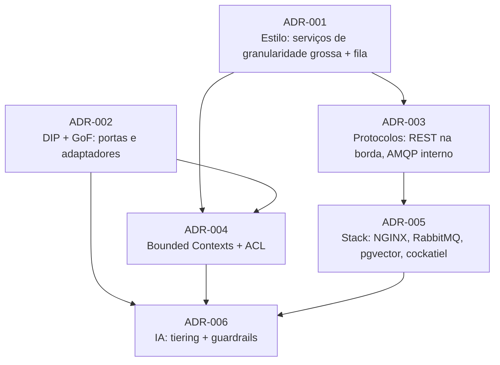

# 7. Registros de Decisões Arquiteturais (ADRs)

> **Projeto:** Check Your Work · **Equipe:** KodeTech
> Todas as decisões estratégicas e seus trade-offs estão registradas nesta pasta, no formato usado pela equipe desde a Sprint 2 (Contexto, Decisão, Alternativas, Consequências, Governança).

| ADR | Título da Decisão Arquitetural | Status | Data |
|---|---|---|---|
| [ADR-001](ADR-001-estilo-arquitetural.md) | Adoção do Estilo Arquitetural (Monólito Modular vs. Microsserviços) | Aceito | 2026-10-03 |
| [ADR-002](ADR-002-desacoplamento-dip-e-padroes-gof.md) | Estratégia de Desacoplamento de Código com DIP e Padrões GoF | Proposto | 2026-10-03 (rev. 2026-11-23) |
| [ADR-003](ADR-003-protocolos-de-integracao.md) | Definição dos Protocolos de Integração (gRPC, REST e RabbitMQ) | Proposto | 2026-11-23 |
| [ADR-004](ADR-004-bounded-contexts-e-acl.md) | Mapeamento de Contextos Delimitados e Camada Anti-Corrupção | Proposto | 2026-11-16 |
| [ADR-005](ADR-005-frameworks-banco-vetorial-e-gateway.md) | Seleção de Frameworks, Banco Vetorial e Stack do API Gateway | Proposto | 2026-11-23 |
| [ADR-006](ADR-006-ia-componentes-probabilisticos-guardrails-e-model-tiering.md) | Integração de Componentes Probabilísticos, Guardrails de IA e Model Tiering | Proposto | 2026-11-23 |

> **Sobre as datas e o status.** Usei as datas reais dos documentos das Sprints 2 e 3 quando a decisão já existia, e a data de hoje (23/11/2026) para as decisões novas. As decisões com status "Proposto" ainda dependem do aceite da equipe; o status só deve virar "Aprovado" depois disso.

## De onde veio cada ADR (rastreabilidade com as Sprints 1 a 3)

O enunciado numera as ADRs de 001 a 006. Nos documentos das sprints anteriores a numeração era outra, e isso precisa ficar explícito para não haver duas "ADR 004" diferentes no repositório:

| ADR do enunciado | Origem nas sprints | O que é novo nesta entrega |
|---|---|---|
| **ADR-001** Estilo arquitetural | **ADR 003** da Sprint 2 (Aceito) | Reorganizada na comparação "monólito modular × microsserviços" pedida pelo enunciado; inclui o contêiner de IA como novo *quantum* |
| **ADR-002** DIP e GoF | **ADR 009 rev. 2** da Sprint 2 + Relatório de Padrões (19/10) | Catálogo de padrões GoF com Factory Method, Adapter e Strategy; extensão para o domínio de IA |
| **ADR-003** Protocolos | Trechos da ADR 003 (fila), ADR 010 (idempotência) e ADR 012 (gateway) | **Nova**: era uma decisão espalhada, agora única; avalia gRPC |
| **ADR-004** Contextos e ACL | **ADR 011** da Sprint 3 | Contexto de Análise Semântica e ACL para o provedor de IA |
| **ADR-005** Frameworks, banco vetorial, gateway | **ADR 012** da Sprint 3 | **Banco vetorial (pgvector)**, cockatiel e servidor de inferência |
| **ADR-006** IA e guardrails | Não existia | **Nova**: inclui o Model Tiering (SLM local × LLM em nuvem), exigido pelo kata |

### ⚠️ Conflito de numeração a resolver antes de entregar

Nas Sprints 1 a 3 os números 004 a 008 foram reservados para o **backlog**, que continua aberto:

| Número antigo (backlog) | Assunto |
|---|---|
| ADR 004 | Banco de auditoria append-only com hash |
| ADR 005 | Autenticação entre serviços |
| ADR 006 | Técnica de comparação de plágio |
| ADR 007 | Versionamento do corretor |
| ADR 008 | Retenção e pseudonimização |

Isso **colide** com ADR-004, ADR-005 e ADR-006 do enunciado, que têm outro assunto. A solução adotada aqui, mesma da Sprint 3, é manter a **numeração do enunciado** nesta pasta e renomear o backlog antigo com o prefixo **BKL-** (`BKL-004` auditoria com hash, `BKL-005` autenticação entre serviços, `BKL-006` plágio, `BKL-007` versionamento, `BKL-008` retenção), até que sejam escritas. Cada ADR abaixo cita o item de backlog que tangencia.
Alternativa, se o grupo preferir: manter 001 a 012 contínuos (antigas 003, 009, 011 e 012 mantêm o número) e só apresentar a tabela de seis ADRs com a correspondência. Qualquer das duas funciona, desde que **um número aponte sempre para a mesma decisão**.

## Visão geral: como as seis decisões se encaixam

